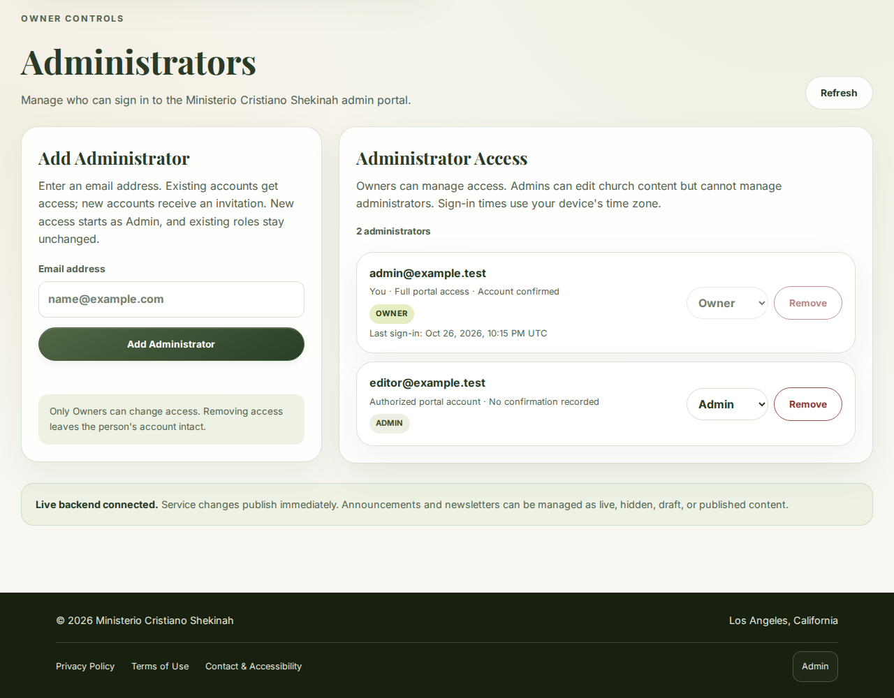
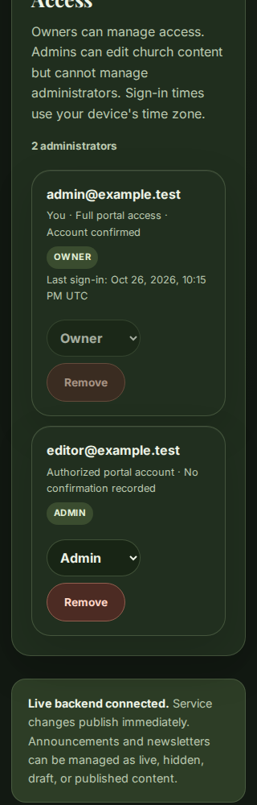
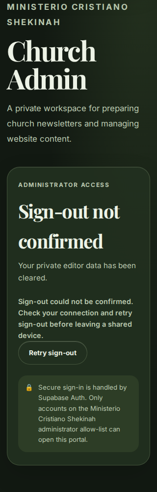
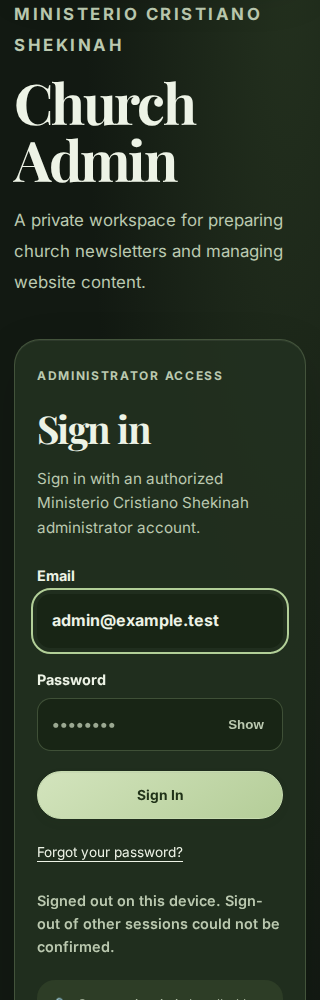

# Website improvements and security repairs — October 26–27, 2026

This record separates deployed changes from automated fixture coverage and work that still needs an administrator or provider decision. The existing GitHub Pages and Supabase services remain in use. No Cloudflare, additional connector or paid service was added. Inter, Playfair Display and the glass/lava-lamp appearance are preserved.

## Releases

| Change | Status and evidence |
| --- | --- |
| Administrator removal | Supabase migration `20261026205057_fix_admin_removal_trigger` applied; `admin-users` Edge Function version 6 now active after the bounded directory update below. An October 26 read-only catalog check confirmed the repaired trigger body. No real account was removed to test it. |
| Visit planning and newsletter reading | [PR #23](https://github.com/ministerioshekinah/church-hub/pull/23) merged as `f3c0e0c474d904076d2c33c54cc087fb3aa00955`. The deployed public assets were checked against reviewed bytes. |
| Newsletter editor review | [PR #24](https://github.com/ministerioshekinah/church-hub/pull/24) merged as `c0fc229e3713ca93d751b261832b031f3a216834`. All four changed production assets matched the reviewed source at 22:42 UTC. |
| Administrator password setup/recovery | [PR #25](https://github.com/ministerioshekinah/church-hub/pull/25) merged as `a33d788ef5ae82022202dbe6ab71c76d7edfcdc1`. The subsequent combined deployment was verified at 23:00 UTC. |
| Authentication connection recovery | [PR #26](https://github.com/ministerioshekinah/church-hub/pull/26) merged as `ac28774da3142e44724c5b1133f2e735b083afb2`. All five deployed admin assets matched the reviewed source at 23:00 UTC. The live recovery form opened and returned to sign-in without entering an address or sending email. |
| Account-change privacy | [PR #27](https://github.com/ministerioshekinah/church-hub/pull/27) merged as `1a7163998234fc7166cf62354addfb7ccc7fdc31` after all four checks passed. It clears prior-account private state and invalidates old identity/membership responses when a session changes to a different user. All five deployed admin assets matched the reviewed source at 23:16 UTC. |

## What changed

Visitors can see the next regular service in Los Angeles time, copy the church address, share visit information and download a single service date for their calendar. The calculation handles daylight-saving transitions and suppresses a speculative reminder if the published schedule is ambiguous or has a special-service notice. The November 1, 2026, 3 PM service was verified as 23:00 UTC after the fall DST change. No calendar connector or subscription is involved.

Newsletter readers have section shortcuts, older/newer links and accent-insensitive search across already loaded published text. English fallback content on Spanish pages carries its actual language for assistive technology. Independent bilingual startup recovery helps if the main script cannot initialize, and information pages remain useful without JavaScript. Missing weekdays say “Day to be confirmed”; they do not silently assume Sunday.

Editors now see unsaved changes in all three content editors. Newsletter review messages identify the exact known starter phrases, missing language content, custom sections without headings and duplicate important-announcement banners. Messages link to the relevant field/language, remain usable at 320 px and do not move focus during ordinary typing. They are advisory: publishing still uses the existing validation, membership checks and version-conflict safeguards. Review text is static and does not inject saved church content into HTML.

A published newsletter has a direct public-view link. Unpublishing, selecting a new draft or signing out removes that link. The Spanish preview now matches the public English fallback behavior and correctly marks the content language. Optional review/account bundles can fail without breaking the primary content editor.

Password setup opens only after server-verified identity and current administrator membership. It supports invitation and recovery landings, current-password input where required, provider-requested verification codes, and a fresh password sign-in after saving. The form validates matching 12-character passwords and leaves server policy authoritative. The logged-out recovery form sends only on explicit submission, uses a fixed church admin redirect, gives account-neutral responses and preserves provider rate-limit behavior. It does not automatically resend email.

## Defects found during this continuation

1. **Password update/sign-out race, fixed before release.** The pinned Supabase SDK has optional session locking. With no lock, a held password-update response could save its old session after sign-out had cleared it. The real-browser test showed the login screen while the SDK still returned a session. The client now explicitly uses the SDK's Web Locks implementation, with its process lock as a same-page fallback. Tests hold the actual SDK request and verify the final SDK session, not just the visible login screen.
2. **Auth fixture fidelity, corrected.** The fixture omitted the Auth API-version response header, so the real SDK discarded modern error codes. This prevented verification-code, unknown-account and rate-limit assertions from exercising the intended branches. The fixture now supplies/exposes that header. This was a test-environment defect, not evidence of production email failure.
3. **Incomplete setup documentation, corrected.** The old administrator setup omitted optional-section/audit migrations and the later removal repair. The ordered nine-migration bootstrap is now documented, with an explicit mapping between the repository repair filename and the production deployment version. Historical audit snapshots are labeled so “proposed” does not get mistaken for current status.
4. **Stalled authentication reads, repaired.** Identity and membership reads had no deadline, so a stalled connection could leave sign-in or password controls locked. The Auth identity fetch and membership query now have ten-second read deadlines. The identity deadline covers the response body as well as headers and preserves caller cancellation. An unavailable membership check now gives retry guidance instead of falsely claiming a membership denial or revoking an otherwise valid session. Mutation requests retain their original behavior and are never automatically retried.
5. **Prior-account private state after an identity change, repaired in PR #27.** An Auth event for a different signed-in user previously left the original tab's verified identity, private draft and dashboard visible in a controlled reproduction. The portal now clears those fields and Owner controls, invalidates earlier reads, and asks for fresh verification. It also rejects old identity/membership responses during initial restoration. Same-user refreshes preserve work. The callback remains synchronous and does not sign out the newly established account. This is a client privacy/state defect; no unauthorized production database access was demonstrated.

No account compromise or unauthorized production content write was demonstrated. The already repaired removal defect was an authorization-revocation failure, not a finding that an attacker had used it.

## Verification evidence

The [per-case verification ledger](verification-2026-10-26.json) now preserves all **332 Node case names and 122 browser case names**, reconciled across Chromium, Firefox and WebKit. That is 698 executions in the final complete application run, not 698 independent vulnerabilities. The historical release counts below show how coverage grew; the additional native-fetch regression is included in the current suite.

| Scope | Result |
| --- | --- |
| Editor release | [All jobs passed](https://github.com/ministerioshekinah/church-hub/actions/runs/40412905966) on head `372e3eae46381857796c5b92876f0570e807cf29`: 258 Node cases and 79 browser journeys + 5 motion journeys + 2 history/session checks per engine. |
| Account local suite | 287 Node tests passed after the SDK locking fix, including the real-SDK session race and 28 account/recovery cases. |
| Account browser suite | [All jobs passed](https://github.com/ministerioshekinah/church-hub/actions/runs/40414390106): 79 existing browser journeys, 5 motion journeys, 2 history checks and 18 account/recovery journeys per engine. |
| Connection recovery | [All jobs passed](https://github.com/ministerioshekinah/church-hub/actions/runs/40415409980): 295 Node cases and five additional real timeout/recovery journeys per engine. A further native-fetch regression confirms that an incomplete JSON response is aborted even after its headers arrive. |
| Account-change privacy | [All jobs passed](https://github.com/ministerioshekinah/church-hub/actions/runs/40417477856) on head `549fcd7d8ebbac96cba0770d0dfdddf8a4e7b3b9`: 305 Node cases, plus 79 existing browser journeys, 5 motion journeys, 2 history checks, 22 account journeys and 5 connection-recovery journeys per engine. All 113 browser case names/results were reconciled across Chromium, Firefox and WebKit. |
| Maintainer verification | All 306 local Node cases passed with four worker processes, including the additional native response-body deadline regression. The final run reported 306 tests, 306 passes, zero failures/cancellations/skips and 6.09 seconds of test duration. `npm test` bounds its worker pool to keep resource use predictable while retaining every test. Incomplete local transcripts were not accepted as evidence of a full-suite pass. |
| Extra-hour sign-out privacy | [All jobs passed](https://github.com/ministerioshekinah/church-hub/actions/runs/40423405179) on `87fef336bf867e97b7853fae46ddc980fd1ac352`: 313 Node tests and 118 journeys per browser engine. |
| Bounded Owner directory | [All jobs passed](https://github.com/ministerioshekinah/church-hub/actions/runs/40423410934) on `e6085cadf2c13afed4beeba63dc595593ad0e715`: 323 Node tests and 118 journeys per engine. |
| Owner read recovery | [All jobs passed](https://github.com/ministerioshekinah/church-hub/actions/runs/40423415517) on `24ddccae77e63b261e5141ab2a3a31f42bcec5ff`: 328 Node tests and 120 journeys per engine. |
| Final application release | [All jobs passed](https://github.com/ministerioshekinah/church-hub/actions/runs/40424489718) on `0fc89b185fdca9599eb5fc0d9ed23382420ecb50`: **332 Node tests and 122 journeys in each of Chromium, Firefox and WebKit**, with zero failures. The per-engine suites are 83 public/admin, 5 motion, 2 history/session, 27 account and 5 connection-recovery journeys. |
| Dependency audits | Both npm dependency graphs reported no known vulnerabilities in the passing editor release and account Node/security job. This is an advisory snapshot, not a guarantee about future vulnerabilities. |
| Editor visual checks | Reviewed Chromium screenshots at 1280 px/light and 320 px/dark. Targeted axe scans and horizontal-overflow checks passed in the browser suite. Screenshot content is fictional. |
| Account visual checks | Reviewed desktop/light and 320 px/dark fixture previews, plus the actual logged-out recovery screen on the live website. No real credentials or email address were entered during live inspection. |
| Live visitor inspection | Confirmed the Spanish next-service date, language persistence from the homepage to the newsletter, and section-link focus on the intended newsletter heading. The single published issue correctly shows the single-issue archive explanation. Existing starter text remains unchanged and is listed for editorial follow-up. |
| Two-hour public-site check | [Run 40407231160](https://github.com/ministerioshekinah/church-hub/actions/runs/40407231160), job `121868017499`, completed successfully. Its final result reports `pass: true`, `requestedMinutes: 120`, **7,201 elapsed seconds, 231 cycles and 24 calendar downloads**, from `2026-10-26T21:47:30.451Z` to `2026-10-26T23:47:31.901Z`. The complete samples are preserved in [the endurance result](endurance-2026-10-26.json). |

The final two-hour run passed its configured growth limits. Retained measurements after forced garbage collection were:

| Visitor page | Documents, start → finish | DOM nodes, start → finish | Event listeners, start → finish | JavaScript heap, start → finish |
| --- | --- | --- | --- | --- |
| Homepage | 1 → 1 | 511 → 511 | 61 → 61 | 2,094,084 → 2,334,472 bytes |
| Newsletter | 1 → 1 | 473 → 704 | 61 → 61 | 2,155,904 → 2,420,072 bytes |

The newsletter's retained node count increased by 231. This remained below the harness's 500-node allowance, but a passing run does not prove zero retained-node growth. These are isolated Chromium fixture measurements, not a production memory profile. The separate scheduled result check was paused after this completed result was reviewed during the extra hour, avoiding a duplicate follow-up.

The earlier candidate endurance run 40403965749 exercises an older public source revision; it is not a substitute for the final public-code run above. The final public-source revision is `15c3dbbb97f86351980630aa8069242e9da5c5d6`; the subsequent PR #23 correction changed a browser assertion, not deployed public behavior. Later editor/account work preserves the visitor behavior exercised by that run. The shared `supabase-config.js` bytes changed only to version the administrator-only loader; the two-hour result is evidence for the specified public revision, not a claim that every later byte was exercised for two hours.

Browser CI uses Playwright Chromium, Firefox and WebKit on Linux, local HTTPS, the pinned vendored SDK and fake Supabase content/accounts. Every backend request is intercepted. The password/email journeys never send real messages or alter real credentials. The two-hour harness keeps two visitor contexts active and checks bounded retained DOM/listener/heap behavior plus interaction correctness; it is not a load test or a tally of independent security findings.

An initial editor CI run exceeded its 10-minute limit while the operating-system package mirror downloaded dependencies unusually slowly. The browser-job allowance was raised to 20 minutes, and the next full run passed. This was infrastructure delay, not a suppressed application failure. Fixture-only JSON reports and screenshots are retained as GitHub Actions artifacts for seven days.

## Remaining work

The screenshot above is the deployed, logged-out form. It is visual proof of the interface, not a claim that a real recovery email was sent or delivered.

See [operational follow-up](OPERATIONS-FOLLOW-UP.md) for the complete decision list. The principal items are the still-observed PostgreSQL 17.6 release, coordinated MFA enrollment/recovery/server enforcement, actual administrator email/recovery verification, and paid-plan availability for leaked-password protection. No plan upgrade or authentication-policy change was made.

An authorized editor also needs to replace published starter copy with real church-approved bilingual content. The new checklist helps identify the known text, but no sermon, event or announcement was invented or published by this release.

Physical Apple-device/history-cache behavior and human assistive-technology review remain outside the automated evidence. Zero axe violations is not a WCAG certification. The code still needs normal maintenance as browser, GitHub and Supabase behavior changes.

## Extra-hour continuation — October 26–27 UTC

The requested additional work began at `2026-10-26T23:37:21Z`. The following releases and evidence were completed during that continuation.

| Change | Release evidence |
| --- | --- |
| Immediate private-state cleanup during sign-out | [PR #29](https://github.com/ministerioshekinah/church-hub/pull/29), merged as `5b5cfd4de2ca9cfe685c5358bbad1cd12d085e2f`. |
| Bounded Owner directory lookup | [PR #30](https://github.com/ministerioshekinah/church-hub/pull/30), merged as `30ecf713eed492e257b990dd9b31c6f0190dcddb`; Supabase `admin-users` **version 6 ACTIVE** at `2026-10-27T00:08:26Z`. Readback matched Git blob `e5df8139fa9687a84de88ce7b919f69a7e3cf6a6`; gateway configuration was preserved and user/Owner middleware still enforces access. |
| Recover stalled Owner reads | [PR #31](https://github.com/ministerioshekinah/church-hub/pull/31), merged as `63f3ca0dc08e1e90cd1d9f8ffd17eacaf49a8502`. |
| Owner account context and retained-node diagnostic | [PR #33](https://github.com/ministerioshekinah/church-hub/pull/33), including the diagnostic from [PR #32](https://github.com/ministerioshekinah/church-hub/pull/32), merged as `bbdc072c5775dc196633172cbb017085f0a67a36` after all four checks passed. PR #32 was closed because its commit was included in this tested descendant. |

At `2026-10-27T00:18:50Z`, all seven live assets matched the reviewed source bytes: `admin/index.html`, `admin.js`, `administrators.js`, `supabase-config.js`, `admin-account.js`, `admin-content-review.js` and `admin-glass.css`. Their SHA-256 values are in the verification ledger. A fresh live browser also loaded administrator versions 10.17 / 1.5 / config 11.9, initialized sign-in, opened the empty recovery form and returned focus to sign-in. No credentials or email address were entered.

The transport checker and constraint-aware finding guidance in [PR #34](https://github.com/ministerioshekinah/church-hub/pull/34) were merged as `585f3c3c424e95fb453332b49f8cb20e3e99eed6` after [all four regression jobs](https://github.com/ministerioshekinah/church-hub/actions/runs/40424973763) and the separate transport workflow passed. This changes verification tooling, not production application behavior.

### Additional findings and repairs

- **Sign-out privacy while waiting.** A held SDK sign-out request left the dashboard and private fields visible until the request settled. The deployed fix clears private drafts, Owner controls and revealed passwords immediately, invalidates earlier reads, and keeps sign-in blocked while the operation is unresolved. A failure before local SDK cleanup offers a deliberate retry.
- **Local cleanup is not proof of remote revocation.** The exact pinned SDK emits `SIGNED_OUT` after clearing its local session even when the global logout endpoint returns an error. The first real-browser run caught an incorrect assumption in the new implementation. The corrected flow waits for the SDK result, distinguishes local cleanup from uncertainty about other sessions, and does not offer a misleading global retry after the SDK has removed the local session. No access token is retained by the UI to work around that behavior. Existing access JWTs can remain valid until expiry.
- **First-page Auth lookup limit.** The old Owner handler mapped only the first 1,000 Auth accounts. Controlled fixtures reproduced missing profiles and misclassification of an existing account beyond that page. The replacement reads administrator profiles directly by ID with four concurrent reads, while invitation lookup checks up to ten pages and fails without invitation or membership changes if it cannot finish. A read-only production count found one Auth account, one administrator and one Owner; this was a capacity defect, not evidence of a currently missing production account.
- **Stalled or overlapping Owner reads.** The Owner list previously had no read deadline and allowed overlapping refresh requests. The deployed UI now bounds the whole read to ten seconds, including SDK preparation and JSON-body consumption. Duplicate refreshes share one request; completed mutations require a fresh list and cancel any older read. Late results cannot refill a signed-out or superseded view. Invitations, role changes and removals receive no automatic timeout or retry.

The Owner screen also displays valid Supabase account-confirmation and last-sign-in information. Missing confirmation is labeled **No confirmation recorded**, not a guessed invitation state. Times use the viewing device's time zone with a visible zone label. No new access rule or authentication policy is inferred from those fields.

The browser-lock failure fixture was also corrected for WebKit. Replacing a native method for one call was not a reliable way to model a temporarily unavailable browser lock manager. The fixture now replaces the exposed manager until the error UI settles, then restores it before retry. This is test fidelity, not a demonstrated production WebKit failure.

### Retained-node diagnostic

[Run 40423890202](https://github.com/ministerioshekinah/church-hub/actions/runs/40423890202) completed three isolated Chromium scenarios, 30 cycles each. The full [diagnostic result](retention-diagnostic-2026-10-27.json) records every sample.

| Scenario | Retained nodes, start → finish | Attached nodes, start → finish | Listeners, start → finish |
| --- | --- | --- | --- |
| Newsletter search and clear | 439 → 469 | 420 → 420 | 61 → 61 |
| Newsletter navigation without search | 451 → 451 | 421 → 421 | 61 → 61 |
| Minimal native search input and clear button | 22 → 52 | 12 → 12 | 14 → 14 |

The same one-retained-node-per-edit pattern appeared without the application, while rendered document nodes and listeners remained stable. This supports a browser-input explanation for the earlier measurement; it does not prove the application is free of every memory leak. No speculative application rewrite was made. These 90 cycles are diagnostic observations, not 90 distinct vulnerabilities.

### Additional Supabase observations

The security advisor continued to report disabled leaked-password protection. The existing Free plan and the documented paid-plan requirement remain unchanged. See [Supabase password protection](https://supabase.com/docs/guides/auth/password-security#password-strength-and-leaked-password-protection).

The performance advisor reported five informational unindexed audit foreign keys: `announcements_created_by_fkey`, `announcements_updated_by_fkey`, `newsletters_created_by_fkey`, `newsletters_updated_by_fkey` and `service_settings_updated_by_fkey`. It also reported three unused indexes: `announcements_public_active_sort_idx`, `newsletters_public_published_idx` and `admin_users_role_idx`. These flags do not establish an exploitable vulnerability or a measured slow query. No indexes were added or removed on the strength of those flags alone. References: [unindexed foreign keys](https://supabase.com/docs/guides/database/database-linter?lint=0001_unindexed_foreign_keys), [unused indexes](https://supabase.com/docs/guides/database/database-linter?lint=0005_unused_index).

### Transport and live access checks

The post-Edge-deployment check at `2026-10-27T00:09:29Z` and the [final post-frontend-deployment read-only result](live-security-2026-10-27.json) at `2026-10-27T00:18:57Z` each passed the same 28 checks; these are repeated confirmations, not 56 independent tests. Each run's sole unsuccessful check was the local HTTP request (`fetch failed`), which received no origin response and was inconclusive about redirect policy. The existing GitHub transport workflow, extended by [PR #34](https://github.com/ministerioshekinah/church-hub/pull/34), independently resolved this at `2026-10-27T00:13:14Z`: both apex and www returned HTTP 301 to `https://mcshekinah.org/`; four TLS 1.2/1.3 handshakes passed normal public-root and hostname/expiry checks, and two TLS 1.0/1.1 handshakes received protocol-version rejection. [Run 40424973756](https://github.com/ministerioshekinah/church-hub/actions/runs/40424973756), job `121928340349`, and [the complete transport result](transport-2026-10-27.json) preserve the evidence. This is not exhaustive cipher, revocation or worldwide-edge coverage.

The live access checks confirmed intended public fields remain readable, hidden/unpublished content and author metadata stay inaccessible, anonymous clients cannot list administrators, forged REST sessions are rejected, and missing/malformed/forged Edge credentials receive HTTP 401. No production account, password, email, membership or content write was used as a test.

Public self-signup remains enabled, while CMS access continues to require allowlisted membership. Missing HSTS, `X-Content-Type-Options` and header-based framing restrictions remain documented GitHub Pages limitations. No new host, proxy, Cloudflare connector or paid service was added.

### New interface previews

These screenshots use fictional accounts and the actual browser application. They do not demonstrate a production account or email operation. The sign-in password field is empty; the dots in the local-only sign-out screenshot are its placeholder.
