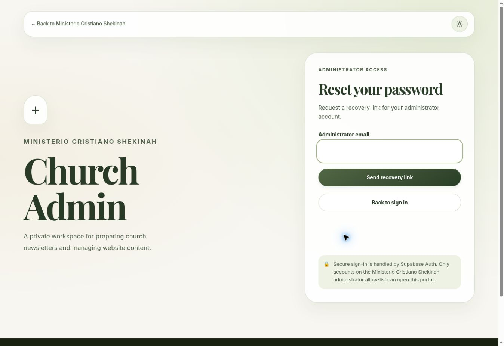

# Website improvements and security repairs — October 26, 2026

This record separates deployed changes from automated fixture coverage and work that still needs an administrator or provider decision. The existing GitHub Pages and Supabase services remain in use. No Cloudflare, additional connector or paid service was added. Inter, Playfair Display and the glass/lava-lamp appearance are preserved.

## Releases

| Change | Status and evidence |
| --- | --- |
| Administrator removal | Supabase migration `20261026205057_fix_admin_removal_trigger` applied; `admin-users` Edge Function version 5 active. An October 26 read-only catalog check confirmed the repaired trigger body. No real account was removed to test it. |
| Visit planning and newsletter reading | [PR #23](https://github.com/ministerioshekinah/church-hub/pull/23) merged as `f3c0e0c474d904076d2c33c54cc087fb3aa00955`. The deployed public assets were checked against reviewed bytes. |
| Newsletter editor review | [PR #24](https://github.com/ministerioshekinah/church-hub/pull/24) merged as `c0fc229e3713ca93d751b261832b031f3a216834`. All four changed production assets matched the reviewed source at 22:42 UTC. |
| Administrator password setup/recovery | [PR #25](https://github.com/ministerioshekinah/church-hub/pull/25) merged as `a33d788ef5ae82022202dbe6ab71c76d7edfcdc1`. The subsequent combined deployment was verified at 23:00 UTC. |
| Authentication connection recovery | [PR #26](https://github.com/ministerioshekinah/church-hub/pull/26) merged as `ac28774da3142e44724c5b1133f2e735b083afb2`. All five deployed admin assets matched the reviewed source at 23:00 UTC. The live recovery form opened and returned to sign-in without entering an address or sending email. |
| Account-change privacy | [PR #27](https://github.com/ministerioshekinah/church-hub/pull/27) merged as `1a7163998234fc7166cf62354addfb7ccc7fdc31` after all four checks passed. It clears prior-account private state and invalidates old identity/membership responses when a session changes to a different user. All five deployed admin assets matched the reviewed source at 23:16 UTC. |

## What changed

Visitors can see the next regular service in Los Angeles time, copy the church address, share visit information and download a single service date for their calendar. The calculation handles daylight-saving transitions and suppresses a speculative reminder if the published schedule is ambiguous or has a special-service notice. The November 1, 2026, 3 PM service was verified as 23:00 UTC after the fall DST change. No calendar connector or subscription is involved.

Newsletter readers have section shortcuts, older/newer links and accent-insensitive search across already loaded published text. English fallback content on Spanish pages carries its actual language for assistive technology. Independent bilingual startup recovery helps if the main script cannot initialize, and information pages remain useful without JavaScript. Missing weekdays say “Day to be confirmed”; they do not silently assume Sunday.

Editors now see unsaved changes in all three content editors. Newsletter review messages identify the exact known starter phrases, missing language content, custom sections without headings and duplicate important-announcement banners. Messages link to the relevant field/language, remain usable at 320 px and do not move focus during ordinary typing. They are advisory: publishing still uses the existing validation, membership checks and version-conflict safeguards. Review text is static and does not inject saved church content into HTML.

A published newsletter has a direct public-view link. Unpublishing, selecting a new draft or signing out removes that link. The Spanish preview now matches the public English fallback behavior and correctly marks the content language. Optional review/account bundles can fail without breaking the primary content editor.

Password setup opens only after server-verified identity and current administrator membership. It supports invitation and recovery landings, current-password input where required, provider-requested verification codes, and a fresh password sign-in after saving. The form validates matching 12-character passwords and leaves server policy authoritative. The logged-out recovery form sends only on explicit submission, uses a fixed church admin redirect, gives account-neutral responses and preserves provider rate-limit behavior. It does not automatically resend email.

## Defects found during this continuation

1. **Password update/sign-out race, fixed before release.** The pinned Supabase SDK has optional session locking. With no lock, a held password-update response could save its old session after sign-out had cleared it. The real-browser test showed the login screen while the SDK still returned a session. The client now explicitly uses the SDK's Web Locks implementation, with its process lock as a same-page fallback. Tests hold the actual SDK request and verify the final SDK session, not just the visible login screen.
2. **Auth fixture fidelity, corrected.** The fixture omitted the Auth API-version response header, so the real SDK discarded modern error codes. This prevented verification-code, unknown-account and rate-limit assertions from exercising the intended branches. The fixture now supplies/exposes that header. This was a test-environment defect, not evidence of production email failure.
3. **Incomplete setup documentation, corrected.** The old administrator setup omitted optional-section/audit migrations and the later removal repair. The ordered nine-migration bootstrap is now documented, with an explicit mapping between the repository repair filename and the production deployment version. Historical audit snapshots are labeled so “proposed” does not get mistaken for current status.
4. **Stalled authentication reads, repaired.** Identity and membership reads had no deadline, so a stalled connection could leave sign-in or password controls locked. The Auth identity fetch and membership query now have ten-second read deadlines. The identity deadline covers the response body as well as headers and preserves caller cancellation. An unavailable membership check now gives retry guidance instead of falsely claiming a membership denial or revoking an otherwise valid session. Mutation requests retain their original behavior and are never automatically retried.
5. **Prior-account private state after an identity change, repaired in PR #27.** An Auth event for a different signed-in user previously left the original tab's verified identity, private draft and dashboard visible in a controlled reproduction. The portal now clears those fields and Owner controls, invalidates earlier reads, and asks for fresh verification. It also rejects old identity/membership responses during initial restoration. Same-user refreshes preserve work. The callback remains synchronous and does not sign out the newly established account. This is a client privacy/state defect; no unauthorized production database access was demonstrated.

No account compromise or unauthorized production content write was demonstrated. The already repaired removal defect was an authorization-revocation failure, not a finding that an attacker had used it.

## Verification evidence

The [per-case verification ledger](verification-2026-10-26.json) preserves the 305 Node case names, all 113 browser case names, each engine's result and the additional native-fetch regression. Repeated engine executions are not counted as different vulnerabilities.

| Scope | Result |
| --- | --- |
| Editor release | [All jobs passed](https://github.com/ministerioshekinah/church-hub/actions/runs/40412905966) on head `372e3eae46381857796c5b92876f0570e807cf29`: 258 Node cases and 79 browser journeys + 5 motion journeys + 2 history/session checks per engine. |
| Account local suite | 287 Node tests passed after the SDK locking fix, including the real-SDK session race and 28 account/recovery cases. |
| Account browser suite | [All jobs passed](https://github.com/ministerioshekinah/church-hub/actions/runs/40414390106): 79 existing browser journeys, 5 motion journeys, 2 history checks and 18 account/recovery journeys per engine. |
| Connection recovery | [All jobs passed](https://github.com/ministerioshekinah/church-hub/actions/runs/40415409980): 295 Node cases and five additional real timeout/recovery journeys per engine. A further native-fetch regression confirms that an incomplete JSON response is aborted even after its headers arrive. |
| Account-change privacy | [All jobs passed](https://github.com/ministerioshekinah/church-hub/actions/runs/40417477856) on head `549fcd7d8ebbac96cba0770d0dfdddf8a4e7b3b9`: 305 Node cases, plus 79 existing browser journeys, 5 motion journeys, 2 history checks, 22 account journeys and 5 connection-recovery journeys per engine. All 113 browser case names/results were reconciled across Chromium, Firefox and WebKit. |
| Maintainer verification | All 306 local Node cases passed with four worker processes, including the additional native response-body deadline regression. The final run reported 306 tests, 306 passes, zero failures/cancellations/skips and 6.09 seconds of test duration. `npm test` bounds its worker pool to keep resource use predictable while retaining every test. Incomplete local transcripts were not accepted as evidence of a full-suite pass. |
| Dependency audits | Both npm dependency graphs reported no known vulnerabilities in the passing editor release and account Node/security job. This is an advisory snapshot, not a guarantee about future vulnerabilities. |
| Editor visual checks | Reviewed Chromium screenshots at 1280 px/light and 320 px/dark. Targeted axe scans and horizontal-overflow checks passed in the browser suite. Screenshot content is fictional. |
| Account visual checks | Reviewed desktop/light and 320 px/dark fixture previews, plus the actual logged-out recovery screen on the live website. No real credentials or email address were entered during live inspection. |
| Live visitor inspection | Confirmed the Spanish next-service date, language persistence from the homepage to the newsletter, and section-link focus on the intended newsletter heading. The single published issue correctly shows the single-issue archive explanation. Existing starter text remains unchanged and is listed for editorial follow-up. |
| Two-hour public-site check | [Run 40407231160](https://github.com/ministerioshekinah/church-hub/actions/runs/40407231160) is still running. It began its timed test at 21:47 UTC and must report `pass: true`, `requestedMinutes: 120` and at least 7,200 elapsed seconds before completion can be claimed. |

The earlier candidate endurance run 40403965749 exercises an older public source revision; it is not a substitute for the final public-code run above. The final public-source revision is `15c3dbbb97f86351980630aa8069242e9da5c5d6`; the subsequent PR #23 correction changed a browser assertion, not deployed public behavior. Later editor/account work does not change the homepage/newsletter assets exercised by that run.

Browser CI uses Playwright Chromium, Firefox and WebKit on Linux, local HTTPS, the pinned vendored SDK and fake Supabase content/accounts. Every backend request is intercepted. The password/email journeys never send real messages or alter real credentials. The two-hour harness keeps two visitor contexts active and checks bounded retained DOM/listener/heap behavior plus interaction correctness; it is not a load test or a tally of independent security findings.

An initial editor CI run exceeded its 10-minute limit while the operating-system package mirror downloaded dependencies unusually slowly. The browser-job allowance was raised to 20 minutes, and the next full run passed. This was infrastructure delay, not a suppressed application failure. Fixture-only JSON reports and screenshots are retained as GitHub Actions artifacts for seven days.

## Remaining work

The screenshot above is the deployed, logged-out form. It is visual proof of the interface, not a claim that a real recovery email was sent or delivered.

See [operational follow-up](OPERATIONS-FOLLOW-UP.md) for the complete decision list. The principal items are the still-observed PostgreSQL 17.6 release, coordinated MFA enrollment/recovery/server enforcement, actual administrator email/recovery verification, and paid-plan availability for leaked-password protection. No plan upgrade or authentication-policy change was made.

An authorized editor also needs to replace published starter copy with real church-approved bilingual content. The new checklist helps identify the known text, but no sermon, event or announcement was invented or published by this release.

Physical Apple-device/history-cache behavior and human assistive-technology review remain outside the automated evidence. Zero axe violations is not a WCAG certification. The code still needs normal maintenance as browser, GitHub and Supabase behavior changes.
